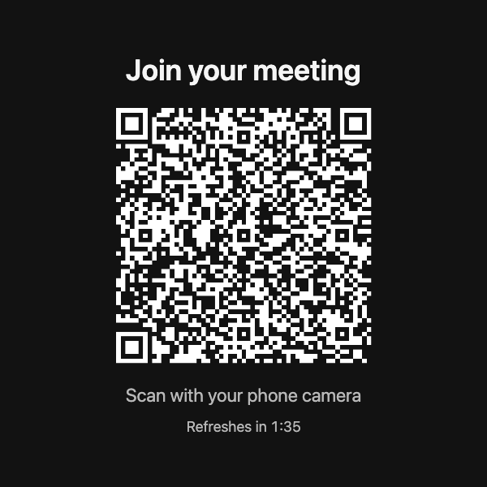
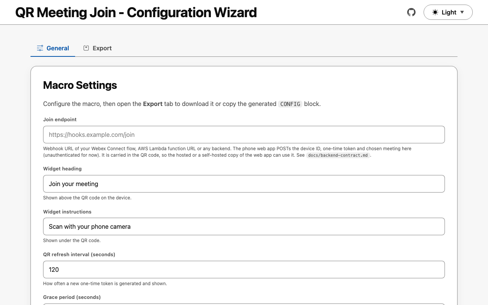
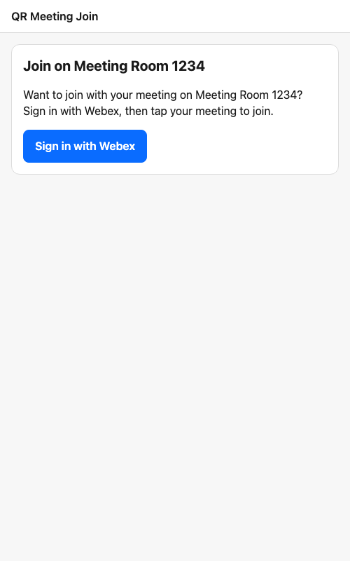

# QR Meeting Join

Scan a QR code on a Webex device to join your calendar meetings from your phone.

Show a QR code on a Cisco RoomOS device. Anyone can scan it with their phone,
sign in with Webex, and tap a meeting from their calendar to have the device
join it - no meeting-invite forwarding, no device pairing, no Webex app.

<p align="center">
  
</p>

## How it works

Nobody taps anything on the device. A person in the room **scans**, then does
everything else on their own phone:

1. The **macro** reads the device's Webex device ID
   (`Status.Webex.DeveloperId`) and name, mints a one-time token every
   `TOKEN_REFRESH_SECONDS`, and saves a RoomOS **web widget**
   (`UserInterface.Extensions.WebWidget.Save`) pointing at the widget page.
   Each refresh re-saves it with the same PanelId and a new URL hash carrying
   those values and the configured join endpoint. It never opens a page, has
   no button and takes no on-device input.
2. The **widget** ([`widget/`](widget/)) renders a QR code on the device
   (600x600, dark theme, white-on-dark QR). The QR code opens the **web app**
   at `#d=<deviceId>&n=<name>&t=<token>&x=<expiry>&e=<join endpoint>`.
3. The person **scans the QR code** with their phone camera. The web app opens
   in the phone's browser and remembers the scan (so it survives sign-in).
4. If they are not signed in, the web app sends them through the Webex OAuth
   implicit grant. They sign in with their normal Webex credentials and land
   back on the web app with their scan restored.
5. The web app loads their calendar meetings from Webex (Webex, Zoom, Teams
   and Google Meet meetings it can join) and shows "Want to join with your
   meeting on _Meeting Room 1234_?".
6. **The person taps their meeting - in the web app on their phone.** The web
   app POSTs the device ID, token and meeting details to the join endpoint
   from the QR code (your Webex Connect webhook, AWS Lambda URL or any backend;
   unauthenticated for now).
7. The middleware sends a Cloud xAPI `Message Send` to the device. The macro
   validates the token (unknown / expired / replayed / device busy -> an
   on-device alert asking the user to rescan) and joins the meeting.

The middleware is built separately; see
[`docs/backend-contract.md`](docs/backend-contract.md) for the exact request and
message formats. Because a Webex Connect inbound webhook cannot return a custom
response, the phone cannot be told whether the join worked - the device
reports the outcome on its own screen.

### Token timing

A token is _shown_ for `TOKEN_REFRESH_SECONDS` (default 120) and _accepted_ for
that plus `TOKEN_GRACE_SECONDS` (default 120), so someone who scans just before
a refresh can still sign in and pick a meeting. Both are set in the wizard.

## Setup checklist

1. Create a [Webex Integration](https://developer.webex.com/my-apps) with
   redirect URI equal to your web app URL and scopes `spark:people_read` and
   `meeting:schedules_read`. Put its client ID in
   [`webapp/config.js`](webapp/config.js).
2. Deploy the middleware (webhook / Lambda URL). Its URL is **not** hard-coded
   in the web app - enter it as the **Join endpoint** in the wizard.
3. Use the [wizard](#live-urls) to configure and download the macro, and
   install it on a Webex-registered device.

To self-host, the wizard's **Export** tab downloads the widget and web app as
zip bundles (the web app bundle includes a generated `config.js`). Upload them
to any HTTPS static host and set the widget/web app URLs in the wizard. The
join endpoint travels in the QR code, so the same web app build works with any
backend; set `allowedEndpointHosts` in `webapp/config.js` to restrict which
endpoint hosts it will post to.

## Live URLs

- Wizard: https://wxsd-sales.github.io/qr-meeting-join/wizard/
- Widget (QR code shown on the device): https://wxsd-sales.github.io/qr-meeting-join/widget/
- Web app (phone sign-in and join): https://wxsd-sales.github.io/qr-meeting-join/webapp/

## Quick start

```sh
npm install
npm test
```

## Project structure

```text
.
├── __tests__/        # Jest tests (macros use jest-mock-xapi)
├── .github/workflows # CI: test, deploy Pages, refresh screenshots
├── assets/           # README screenshots and animated diagrams (generated)
├── diagrams/         # mermaid flow diagrams
├── macros/           # single-file RoomOS macros
├── scripts/          # dev automation (serve, screenshots, deploy-macro)
├── docs/             # middleware contract
├── widget/           # on-device QR code page (Pages: /widget/)
├── webapp/           # phone sign-in + meeting picker (Pages: /webapp/)
└── wizard/           # macro configuration app (Pages: /wizard/)
```

## Installing the macro

1. Open the device web interface: **Customization > Macro Editor**.
2. Create a new macro and paste the contents of [`macros/main.js`](macros/main.js)
   (or the file downloaded from the wizard).
3. Save and enable the macro.

The `CONFIG` block in the macro is managed by the [wizard](#live-urls) - use
**Copy config** to grab an updated block, or **Download macro** for a
ready-to-import macro file, after changing settings.

### Deploy to a device over xAPI

`npm run deploy:macro` uploads a macro straight to a device using
[`jsxapi`](https://github.com/cisco-ce/jsxapi). Provide credentials via
environment variables (never commit them):

```sh
DEVICE_HOST=192.0.2.10 DEVICE_USERNAME=admin DEVICE_PASSWORD=... \
  npm run deploy:macro
```

Set `MACRO_FILE` to deploy a macro other than `macros/main.js`, and
`MACRO_ACTIVATE=false` to upload without enabling it.

## Dev scripts

| Command                    | Description                                                                     |
| -------------------------- | ------------------------------------------------------------------------------- |
| `npm run serve`            | Serve the repo locally (wizard + webapp) with Node's http server                |
| `npm run serve:lan`        | Serve the repo locally on LAN address (wizard + webapp) with Node's http server |
| `npm run screenshots`      | Capture `assets/*-light.png` / `*-dark.png` via headless Chrome                 |
| `npm run deploy:macro`     | Upload a macro to a device over xAPI (see below)                                |
| `npm run lint`             | Lint with ESLint                                                                |
| `npm run format`           | Format with Prettier (`npm run format:check` to verify)                         |
| `npm run diagrams`         | Render Mermaid diagrams to animated SVGs in `.preview/` (local preview)         |
| `npm run diagrams:publish` | Render Mermaid diagrams to animated SVGs in `assets/` (GitHub Actions only)     |
| `npm test`                 | Run the Jest suite                                                              |

Screenshots use a headless Chrome/Chromium already installed on your machine.
Set `CHROME_BIN` to override binary detection.

<!-- Screenshots are regenerated by .github/workflows/screenshots.yml -->

## Configuration wizard

<picture>
  <source media="(prefers-color-scheme: dark)" srcset="assets/wizard-dark.png">
  <source media="(prefers-color-scheme: light)" srcset="assets/wizard-light.png">
  
</picture>

## Phone web app

<picture>
  <source media="(prefers-color-scheme: dark)" srcset="assets/webapp-dark.png">
  <source media="(prefers-color-scheme: light)" srcset="assets/webapp-light.png">
  
</picture>

## Flow diagrams

### 1. Macro start-up and the web widget

When the macro starts it reads the device's Webex device ID and name, mints a
one-time token and saves the web widget. A timer repeats the mint-and-save step
every `TOKEN_REFRESH_SECONDS`, re-saving the widget with the same PanelId and a
new URL hash. The widget page itself is loaded from GitHub Pages or your own
host.

<picture>
  <source media="(prefers-color-scheme: dark)" srcset="assets/1-macro-web-widget-dark.svg">
  <source media="(prefers-color-scheme: light)" srcset="assets/1-macro-web-widget-light.svg">
  
</picture>

### 2. Scanning, signing in and tapping a meeting

A person scans the QR code with their phone camera. The web app opens and
remembers the scan; if they are not signed in to Webex they sign in first,
otherwise their meeting list loads straight away. They tap Join on a meeting in
the web app, which sends the join request to the configured join endpoint.

<picture>
  <source media="(prefers-color-scheme: dark)" srcset="assets/2-scan-and-join-dark.svg">
  <source media="(prefers-color-scheme: light)" srcset="assets/2-scan-and-join-light.svg">
  
</picture>

### 3. Backend request and the macro joining

The backend behind the join endpoint makes a Cloud xAPI `Message.Send` request
to the target device ID with the encoded join payload. The macro validates the
token, device state and destination, then joins the meeting (`Webex Join` or
`Dial`, plus any PIN as DTMF) - or shows an error on the screen, for example
when the QR code has expired.

<picture>
  <source media="(prefers-color-scheme: dark)" srcset="assets/3-backend-message-send-dark.svg">
  <source media="(prefers-color-scheme: light)" srcset="assets/3-backend-message-send-light.svg">
  
</picture>

The sources are in [`diagrams/`](diagrams/). Running `npm run diagrams` renders
them to `.preview/` (git-ignored) for a local look; the animation syntax is
documented in the header of `scripts/build-mermaid-svgs.mjs`. The committed SVGs
in `assets/` are regenerated by the `build-diagrams.yml` workflow when
`diagrams/**` changes on `main`.

## Deployment

Pushing to `main` triggers `deploy-pages.yml`, which publishes `wizard/`, `widget/` and
`webapp/` to GitHub Pages. Enable Pages with the **GitHub Actions** source in
your repository settings (Settings > Pages).

## License

All contents are licensed under the MIT license. Please see [license](LICENSE) for details.

## Disclaimer

Everything included is for demo and Proof of Concept purposes only. Use of the site is solely at your own risk. This site may contain links to third party content, which we do not warrant, endorse, or assume liability for. These demos are for Cisco Webex use cases, but are not Official Cisco Webex Branded demos.

## Questions

Please contact the WXSD team at [wxsd@external.cisco.com](mailto:wxsd@external.cisco.com?subject=qr-meeting-join) for questions. Or, if you're a Cisco internal employee, reach out to us on the Webex App via our bot (globalexpert@webex.bot). In the "Engagement Type" field, choose the "API/SDK Proof of Concept Integration Development" option to make sure you reach our team.
